# Database Design — AM² Landing Page

| Attribute | Value |
|---|---|
| Status | Documentation based on repository artifacts, not an inspection of a running database instance. |
| Primary DDL source | `database/01_schema.sql` |
| Media DDL change | `database/03_directus_files.sql` |
| Content data and changes | `database/02_seed.sql`, `04_copy_en_id.sql` through `10_combined_platform_page.sql` |
| Application integration | `web/src/lib/types/` and `web/src/lib/server/` |
| Declared CMS | Directus `^12.5.0` in `cms/package.json` |

## 1. Purpose and audit scope

The database stores the landing page structure and content, domain data (platforms, products, deployment models, and responsibilities), navigation, SEO metadata, translations, Directus media references, and the contact lead model.

The application `public` schema has **22 custom tables**: 21 are created in `01_schema.sql` and `file_translations` is added by `03_directus_files.sql`. The `directus_files` system table owns the files, but its DDL is not in this repository because Directus bootstrap creates it. In the documented execution order, `04_copy_en_id.sql` also creates nine snapshot tables in the `copy_backup` schema; that schema is not a public application collection.

This document does not state the following as implemented because the required artifacts were not found in the repository:

- the complete `directus_files` definition, storage adapter, transformation presets, or actual file data;
- an export of `directus_collections`, `directus_fields`, `directus_relations`, roles, policies, permissions, Flows, webhooks, or PostgreSQL RLS;
- a frontend endpoint or form action that writes `contact_requests`;
- a running IP anonymization job or rate-limiting mechanism.

DDL comments and environment templates may describe intent, but they are not evidence of an applied Directus configuration or an operational process.

## 2. Data architecture

```text
Directus / PostgreSQL
├── Reference data: locales, platforms, deployment_models, responsibilities,
│   operating_locations, contact_channels
├── Pages: pages + page_translations
├── Content: content_sections + translations + section_items
│   └── M:N placement: page_content_sections
├── Navigation: navigation_items + translations
├── Domain: products and deployment_model_responsibilities + translations
├── Media: directus_files (Directus) + file_translations (custom)
└── Leads: contact_requests

SvelteKit server loaders ──Directus SDK──► Directus collections/PostgreSQL
```

The following principles are implemented in the schema and code:

- **Structure and text are separated.** Content entities store structure, ordering, visibility, relations, and media. Visitor-facing text is stored in `*_translations` tables.
- **Sections can be reused.** `pages` and `content_sections` have an M:N relationship through `page_content_sections`.
- **Domain content is derived while loading.** A `product_list` section queries `products` using `pages.platform_id`. A `responsibility_matrix` section queries `deployment_model_responsibilities` using `pages.deployment_model_id`.
- **Directus manages media.** Custom tables store UUIDs in `*_image_id` fields and localized alt text in `file_translations`.
- **Custom timestamps are consistent.** `created_at` is populated by `DEFAULT now()` on insert. A trigger updates `updated_at` only when a row actually changes.

## 3. Collections and responsibilities

| Group | Table/collection | Responsibility |
|---|---|---|
| Locale | `locales` | Available, active, and database-default locales. |
| Reference | `platforms`, `deployment_models`, `responsibilities`, `operating_locations` | Master data for pages, the responsibility matrix, and future form options. |
| Reference translations | `responsibility_translations`, `product_translations`, `operating_location_translations` | Localized domain text. |
| Domain relations | `deployment_model_responsibilities`, `products` | Responsibility owner per deployment model and product categories per platform. |
| Company contact | `contact_channels` | Active company email, phone, or WhatsApp contacts. |
| Pages | `pages`, `page_translations` | Locale-prefix-free routes, templates, publication state, domain context, and SEO. |
| Content | `content_sections`, `content_section_translations`, `page_content_sections`, `section_items`, `section_item_translations` | Section blocks, their text, placement per page, and repeating items. |
| Navigation | `navigation_items`, `navigation_item_translations` | Header/footer tree and localized labels. |
| Media | `directus_files`, `file_translations` | Directus files/dimensions and locale-specific alt text. |
| Leads | `contact_requests` | Contact request model and consent/attribution metadata. |

## 4. Data dictionary conventions

- **PK**: primary key. **FK**: foreign key. **UQ**: unique constraint.
- `NN` means `NOT NULL`; `NULL` means the value may be empty.
- Except for `locales`, every custom table has `id integer GENERATED BY DEFAULT AS IDENTITY` as its PK.
- Every custom table, including `locales` and `file_translations`, has:

  | Column | Type | Nullable | Default | Description |
  |---|---|---|---|---|
  | `created_at` | `timestamptz` | NN | `now()` | Time the row was created. |
  | `updated_at` | `timestamptz` | NN | `now()` | Updated by the `set_updated_at()` trigger when the row changes. |

- PostgreSQL PKs and UQs create implicit unique indexes. The **Additional indexes** sections list only indexes explicitly created by the scripts.
- A `—` default means the column has no explicit default. A table-specific dictionary omits only the two standard timestamp columns above.
- `image_id` becomes an FK to `directus_files(id)` only after `03_directus_files.sql` has run.

## 5. Data dictionary

### 5.1 Locale and master data

#### `locales`

| Column | Type | Nullable | Default | Key | Description |
|---|---|---:|---|---|---|
| `code` | `varchar(10)` | NN | — | PK | Locale code, such as `en` or `id`. |
| `name` | `varchar(50)` | NN | — | — | Language name for the language switcher. |
| `is_default` | `boolean` | NN | `false` | — | Database default locale marker. |
| `is_active` | `boolean` | NN | `true` | — | Only active locales are read for the language switcher. |

- Check: the code matches `^[a-z]{2}(-[A-Z]{2})?$`; a default locale must be active.
- Additional index: `locales_is_default_uidx UNIQUE (is_default) WHERE is_default` limits the database to at most one default locale. It does not guarantee that a default locale exists.

#### `platforms`

| Column | Type | Nullable | Default | Key | Description |
|---|---|---:|---|---|---|
| `code` | `varchar(50)` | NN | — | UQ | Stable snake_case identifier. |
| `name` | `varchar(100)` | NN | — | UQ | Untranslated brand name. |
| `sort_order` | `smallint` | NN | `0` | — | Reference-data order. |
| `is_active` | `boolean` | NN | `true` | — | Active state. |

- Check: `code` matches `^[a-z][a-z0-9_]*$`; `sort_order >= 0`.
- There is no UQ or additional index for `sort_order`.

#### `deployment_models`

| Column | Type | Nullable | Default | Key | Description |
|---|---|---:|---|---|---|
| `code` | `varchar(50)` | NN | — | UQ | Stable snake_case identifier. |
| `name` | `varchar(100)` | NN | — | UQ | Deployment model name. |
| `sort_order` | `smallint` | NN | `0` | — | Reference-data order. |
| `is_active` | `boolean` | NN | `true` | — | Active state. |

- Check: a snake_case `code` and `sort_order >= 0`.
- There is no UQ or additional index for `sort_order`.

#### `responsibilities`

| Column | Type | Nullable | Default | Key | Description |
|---|---|---:|---|---|---|
| `code` | `varchar(50)` | NN | — | UQ | Snake_case identifier for a responsibility-matrix row. |
| `sort_order` | `smallint` | NN | `0` | — | Responsibility-matrix row order. |

- Check: a snake_case `code` and `sort_order >= 0`.
- This table has no `is_active` field and no UQ for `sort_order`.

#### `operating_locations`

| Column | Type | Nullable | Default | Key | Description |
|---|---|---:|---|---|---|
| `code` | `varchar(50)` | NN | — | UQ | Snake_case location identifier. |
| `sort_order` | `smallint` | NN | `0` | — | Reference-data order. |
| `is_active` | `boolean` | NN | `true` | — | Active state. |

- Check: a snake_case `code` and `sort_order >= 0`.
- There is no UQ or additional index for `sort_order`.

#### `contact_channels`

| Column | Type | Nullable | Default | Key | Description |
|---|---|---:|---|---|---|
| `channel_type` | `varchar(10)` | NN | — | UQ with `value` | `email`, `phone`, or `whatsapp`. |
| `value` | `varchar(254)` | NN | — | UQ with `channel_type` | An email address or E.164 phone number. |
| `sort_order` | `smallint` | NN | `0` | — | Display order. |
| `is_active` | `boolean` | NN | `true` | — | Active state. |

- UQ: `(channel_type, value)`.
- Check: the type is limited to the three values above; `sort_order >= 0`; email is checked by regex; `phone` and `whatsapp` must match `^\+[1-9][0-9]{7,14}$`.
- There are no explicit secondary indexes.

### 5.2 Reference translations and domain relations

#### `responsibility_translations`

| Column | Type | Nullable | Default | Key | Description |
|---|---|---:|---|---|---|
| `responsibility_id` | `integer` | NN | — | FK, UQ with `locale_code` | → `responsibilities(id)`, delete cascade. |
| `locale_code` | `varchar(10)` | NN | — | FK, UQ with `responsibility_id` | → `locales(code)`, delete restrict. |
| `name` | `varchar(100)` | NN | — | — | Responsibility-matrix row label. |

- UQ: `(responsibility_id, locale_code)`.
- Check: `btrim(name) <> ''`.

#### `deployment_model_responsibilities`

| Column | Type | Nullable | Default | Key | Description |
|---|---|---:|---|---|---|
| `deployment_model_id` | `integer` | NN | — | FK, UQ with `responsibility_id` | → `deployment_models(id)`, delete cascade. |
| `responsibility_id` | `integer` | NN | — | FK, UQ with `deployment_model_id` | → `responsibilities(id)`, delete cascade. |
| `owner_party` | `varchar(10)` | NN | — | — | Owner: `am2` or `customer`. |

- UQ: `(deployment_model_id, responsibility_id)` ensures one owner for a pair.
- Check: `owner_party IN ('am2', 'customer')`.
- Additional index: `deployment_model_responsibilities_responsibility_id_idx (responsibility_id)`.

#### `products`

| Column | Type | Nullable | Default | Key | Description |
|---|---|---:|---|---|---|
| `platform_id` | `integer` | NN | — | FK | → `platforms(id)`, delete restrict. |
| `code` | `varchar(60)` | NN | — | UQ | Snake_case product category identifier. |
| `image_id` | `uuid` | NULL | — | FK after script 03 | → `directus_files(id)`, delete set null. |
| `sort_order` | `smallint` | NN | `0` | — | Product order within a platform. |
| `is_active` | `boolean` | NN | `true` | — | Only active products are loaded by the application. |

- Check: a snake_case `code` and `sort_order >= 0`.
- Additional indexes: `products_platform_sort_idx (platform_id, sort_order)` and `products_image_id_idx (image_id)`.
- There is no UQ `(platform_id, sort_order)`.

#### `product_translations`

| Column | Type | Nullable | Default | Key | Description |
|---|---|---:|---|---|---|
| `product_id` | `integer` | NN | — | FK, UQ with `locale_code` | → `products(id)`, delete cascade. |
| `locale_code` | `varchar(10)` | NN | — | FK, UQ with `product_id` | → `locales(code)`, delete restrict. |
| `name` | `varchar(150)` | NN | — | — | Product category name. |
| `description` | `text` | NN | — | — | Product description. |

- UQ: `(product_id, locale_code)`.
- Check: `name` and `description` must not be blank after `btrim`.

#### `operating_location_translations`

| Column | Type | Nullable | Default | Key | Description |
|---|---|---:|---|---|---|
| `operating_location_id` | `integer` | NN | — | FK, UQ with `locale_code` | → `operating_locations(id)`, delete cascade. |
| `locale_code` | `varchar(10)` | NN | — | FK, UQ with `operating_location_id` | → `locales(code)`, delete restrict. |
| `name` | `varchar(100)` | NN | — | — | Localized operating location name. |

- UQ: `(operating_location_id, locale_code)`.
- Check: `btrim(name) <> ''`.

### 5.3 Pages and content

#### `pages`

| Column | Type | Nullable | Default | Key | Description |
|---|---|---:|---|---|---|
| `path` | `varchar(255)` | NN | — | UQ | Path without a locale prefix. The root is `/`. |
| `template` | `varchar(20)` | NN | — | — | Page renderer template. |
| `platform_id` | `integer` | NULL | — | FK | → `platforms(id)`, delete restrict. |
| `deployment_model_id` | `integer` | NULL | — | FK | → `deployment_models(id)`, delete restrict. |
| `is_published` | `boolean` | NN | `false` | — | Public availability state. |
| `published_at` | `timestamptz` | NULL | — | — | Required when a page is published. |

- `template` is limited to `home`, `solution`, `platform`, `product`, `service`, `feature`, `contact`, or `about`.
- `path` must be lowercase, use slash/hyphen-separated components, and permits the `/` root.
- Cross-column checks: `home` if and only if `path = '/'`; `platform_id` is required for `product` and `feature`, optional for `platform` (NULL identifies the combined AM² PTT & Command Center page), and must be NULL for all other templates; `deployment_model_id` is required exactly for `service`; published pages must have `published_at`.
- Additional indexes:
  - `pages_singleton_template_uidx UNIQUE (template) WHERE template IN ('home', 'contact', 'about')`;
  - `pages_platform_template_uidx UNIQUE (platform_id, template) WHERE template IN ('platform', 'product')`;
  - `pages_combined_platform_uidx UNIQUE (template) WHERE template = 'platform' AND platform_id IS NULL` (one combined platform page);
  - `pages_service_deployment_model_uidx UNIQUE (deployment_model_id) WHERE template = 'service'`;
  - `pages_platform_id_idx (platform_id)` and `pages_deployment_model_id_idx (deployment_model_id)`.
- There is no constraint limiting a platform to one `feature` page.

#### `page_translations`

| Column | Type | Nullable | Default | Key | Description |
|---|---|---:|---|---|---|
| `page_id` | `integer` | NN | — | FK, UQ with `locale_code` | → `pages(id)`, delete cascade. |
| `locale_code` | `varchar(10)` | NN | — | FK, UQ with `page_id` | → `locales(code)`, delete restrict. |
| `title` | `varchar(150)` | NN | — | — | The `<title>` content. |
| `meta_description` | `varchar(300)` | NULL | — | — | The meta description content. |

- UQ: `(page_id, locale_code)`.
- Check: `btrim(title) <> ''`.

#### `content_sections`

| Column | Type | Nullable | Default | Key | Description |
|---|---|---:|---|---|---|
| `section_key` | `varchar(100)` | NN | — | UQ | Stable section identifier for administrators and code. |
| `section_type` | `varchar(30)` | NN | — | — | Frontend component that must render the section. |
| `image_id` | `uuid` | NULL | — | FK after script 03 | → `directus_files(id)`, delete set null. |
| `cta_page_id` | `integer` | NULL | — | FK | → `pages(id)`, delete restrict. |

- `section_key` must be snake_case.
- `section_type` is limited to `hero`, `icon_grid`, `card_grid`, `carousel`, `split_list`, `split_media`, `process_steps`, `accordion`, `cta`, `product_list`, `responsibility_matrix`, `contact_form`, or `footer`.
- Additional indexes: `content_sections_image_id_idx (image_id)` and `content_sections_cta_page_id_idx (cta_page_id)`.

#### `content_section_translations`

| Column | Type | Nullable | Default | Key | Description |
|---|---|---:|---|---|---|
| `content_section_id` | `integer` | NN | — | FK, UQ with `locale_code` | → `content_sections(id)`, delete cascade. |
| `locale_code` | `varchar(10)` | NN | — | FK, UQ with `content_section_id` | → `locales(code)`, delete restrict. |
| `eyebrow` | `varchar(100)` | NULL | — | — | Small label above the heading. |
| `heading` | `varchar(255)` | NULL | — | — | Section heading. |
| `heading_highlight` | `varchar(255)` | NULL | — | — | Accent-rendered substring of `heading`. |
| `body` | `text` | NULL | — | — | Section body text. |
| `cta_label` | `varchar(100)` | NULL | — | — | CTA button label. |

- UQ: `(content_section_id, locale_code)`.
- Check: `heading_highlight` must be a substring of `heading` when supplied; at least one of `eyebrow`, `heading`, `body`, or `cta_label` must be non-null.
- The latter check does not reject empty strings.

#### `page_content_sections`

| Column | Type | Nullable | Default | Key | Description |
|---|---|---:|---|---|---|
| `page_id` | `integer` | NN | — | FK, UQ with `content_section_id` | → `pages(id)`, delete cascade. |
| `content_section_id` | `integer` | NN | — | FK, UQ with `page_id` | → `content_sections(id)`, delete restrict. |
| `sort_order` | `smallint` | NN | `0` | — | Section order within a page. |
| `is_visible` | `boolean` | NN | `true` | — | Hides this placement on this page only. |

- UQ: `(page_id, content_section_id)`.
- Check: `sort_order >= 0`.
- Additional indexes: `page_content_sections_page_sort_idx (page_id, sort_order)` and `page_content_sections_content_section_id_idx (content_section_id)`.
- The application loader orders by `sort_order`, then `id`; `sort_order` is not unique per page.

#### `section_items`

| Column | Type | Nullable | Default | Key | Description |
|---|---|---:|---|---|---|
| `content_section_id` | `integer` | NN | — | FK | → `content_sections(id)`, delete cascade. |
| `image_id` | `uuid` | NULL | — | FK after script 03 | → `directus_files(id)`, delete set null. |
| `icon_key` | `varchar(50)` | NULL | — | — | Frontend icon name in kebab-case. |
| `link_page_id` | `integer` | NULL | — | FK | → `pages(id)`, delete restrict. |
| `sort_order` | `smallint` | NN | `0` | — | Item order within a section. |
| `is_visible` | `boolean` | NN | `true` | — | The loader reads only visible items. |

- Check: when supplied, `icon_key` matches `^[a-z0-9]+(-[a-z0-9]+)*$`; `sort_order >= 0`.
- Additional indexes: `section_items_section_sort_idx (content_section_id, sort_order)`, `section_items_image_id_idx (image_id)`, and `section_items_link_page_id_idx (link_page_id)`.
- There is no unique section/order pair.

#### `section_item_translations`

| Column | Type | Nullable | Default | Key | Description |
|---|---|---:|---|---|---|
| `section_item_id` | `integer` | NN | — | FK, UQ with `locale_code` | → `section_items(id)`, delete cascade. |
| `locale_code` | `varchar(10)` | NN | — | FK, UQ with `section_item_id` | → `locales(code)`, delete restrict. |
| `title` | `varchar(255)` | NULL | — | — | Item title or question. |
| `description` | `text` | NULL | — | — | Item body or answer. |
| `link_label` | `varchar(100)` | NULL | — | — | Item link label. |

- UQ: `(section_item_id, locale_code)`.
- Check: at least one of `title`, `description`, or `link_label` must be non-null. Empty strings can still pass.

### 5.4 Navigation

#### `navigation_items`

| Column | Type | Nullable | Default | Key | Description |
|---|---|---:|---|---|---|
| `menu_location` | `varchar(10)` | NN | — | — | `header` or `footer`. |
| `parent_id` | `integer` | NULL | — | FK | → `navigation_items(id)`, delete cascade. |
| `page_id` | `integer` | NULL | — | FK | → `pages(id)`, delete restrict. |
| `sort_order` | `smallint` | NN | `0` | — | Sibling order. |
| `is_visible` | `boolean` | NN | `true` | — | Item display state. |

- Check: location is limited to `header/footer`; an item cannot be its own parent; `sort_order >= 0`.
- The `navigation_items_check_tree_trg` trigger calls `navigation_items_check_tree()` on insert or a `parent_id`/`menu_location` change. It requires a parent in the same location, prevents a parent with children from being moved between locations without first moving its children, and rejects update cycles.
- Additional indexes: `navigation_items_location_parent_sort_idx (menu_location, parent_id, sort_order)`, `navigation_items_parent_id_idx (parent_id)`, and `navigation_items_page_id_idx (page_id)`.
- There is no UQ for sibling positions and no composite FK `(parent_id, menu_location)`.

#### `navigation_item_translations`

| Column | Type | Nullable | Default | Key | Description |
|---|---|---:|---|---|---|
| `navigation_item_id` | `integer` | NN | — | FK, UQ with `locale_code` | → `navigation_items(id)`, delete cascade. |
| `locale_code` | `varchar(10)` | NN | — | FK, UQ with `navigation_item_id` | → `locales(code)`, delete restrict. |
| `label` | `varchar(100)` | NN | — | — | Navigation label. |

- UQ: `(navigation_item_id, locale_code)`.
- Check: `btrim(label) <> ''`.

### 5.5 Directus media

#### `directus_files`

This Directus system table is the FK target for `products.image_id`, `content_sections.image_id`, and `section_items.image_id`. Web code requests `id`, `width`, and `height` from the file relation to create asset URLs and image dimension attributes.

- The table's column DDL, PK, indexes, storage, and permissions are not available in the repository.
- Script 03 raises an exception when this table is absent.
- Deleting a file sets the three image FKs to `NULL` (`ON DELETE SET NULL`).

#### `file_translations`

| Column | Type | Nullable | Default | Key | Description |
|---|---|---:|---|---|---|
| `directus_files_id` | `uuid` | NN | — | FK, UQ with `locale_code` | → `directus_files(id)`, delete cascade. |
| `locale_code` | `varchar(10)` | NN | — | FK, UQ with `directus_files_id` | → `locales(code)`, delete restrict. |
| `alt_text` | `varchar(255)` | NN | — | — | Localized image alt text. |

- UQ: `(directus_files_id, locale_code)`.
- Check: `btrim(alt_text) <> ''`.
- The `file_translations_set_updated_at_trg` trigger manages `updated_at`.
- The frontend treats decorative images as `alt=""`; no empty translation row is valid.

### 5.6 Contact leads

#### `contact_requests`

| Column | Type | Nullable | Default | Key | Description |
|---|---|---:|---|---|---|
| `full_name` | `varchar(150)` | NN | — | — | Prospective customer name. |
| `work_email` | `varchar(254)` | NN | — | — | Prospective customer work email. |
| `phone_number` | `varchar(16)` | NULL | — | — | E.164 number, if supplied. |
| `company_name` | `varchar(200)` | NN | — | — | Company or organization name. |
| `job_role` | `varchar(100)` | NULL | — | — | Free-text role. |
| `platform_id` | `integer` | NN | — | FK | → `platforms(id)`, delete restrict. |
| `deployment_model_id` | `integer` | NN | — | FK | → `deployment_models(id)`, delete restrict. |
| `operating_location_id` | `integer` | NN | — | FK | → `operating_locations(id)`, delete restrict. |
| `message` | `text` | NULL | — | — | Message, up to 5,000 characters. |
| `consent_given_at` | `timestamptz` | NN | — | — | Consent timestamp. |
| `locale_code` | `varchar(10)` | NN | — | FK | → `locales(code)`, delete restrict. |
| `source_page_id` | `integer` | NULL | — | FK | → `pages(id)`, delete set null. |
| `status` | `varchar(20)` | NN | `'new'` | — | Lead handling status. |
| `ip_address` | `varchar(45)` | NULL | — | — | IPv4/IPv6 value that can be cast to `inet`. |
| `user_agent` | `varchar(500)` | NULL | — | — | Request user agent. |

- Check: `status` is `new`, `contacted`, `qualified`, `closed_won`, or `closed_lost`; names and companies cannot be whitespace only; email and phone number are regex-validated; `message` is at most 5,000 characters; when supplied, `ip_address` must be castable to `inet`.
- Additional indexes:
  - `contact_requests_status_created_at_idx (status, created_at DESC)`;
  - `contact_requests_work_email_idx (lower(work_email))`;
  - `contact_requests_ip_created_at_idx (ip_address, created_at DESC) WHERE ip_address IS NOT NULL`;
  - `contact_requests_platform_id_idx (platform_id)`;
  - `contact_requests_deployment_model_id_idx (deployment_model_id)`;
  - `contact_requests_operating_location_id_idx (operating_location_id)`;
  - `contact_requests_source_page_id_idx (source_page_id) WHERE source_page_id IS NOT NULL`.
- The table and an example query exist, but the current web application has no submit route/action or `createItem` call that creates leads.

## 6. Relationships and ERD

All translation tables and `contact_requests` with `locale_code` also have an N:1 relationship to `locales`; the diagram includes those relationships to show the locale dependency.

```mermaid
erDiagram
    locales ||--o{ responsibility_translations : locale_code
    locales ||--o{ product_translations : locale_code
    locales ||--o{ operating_location_translations : locale_code
    locales ||--o{ page_translations : locale_code
    locales ||--o{ content_section_translations : locale_code
    locales ||--o{ section_item_translations : locale_code
    locales ||--o{ navigation_item_translations : locale_code
    locales ||--o{ file_translations : locale_code
    locales ||--o{ contact_requests : locale_code

    platforms ||--o{ products : platform_id
    platforms ||--o{ pages : platform_id
    platforms ||--o{ contact_requests : platform_id
    deployment_models ||--o{ pages : deployment_model_id
    deployment_models ||--o{ deployment_model_responsibilities : deployment_model_id
    deployment_models ||--o{ contact_requests : deployment_model_id
    responsibilities ||--o{ responsibility_translations : responsibility_id
    responsibilities ||--o{ deployment_model_responsibilities : responsibility_id
    products ||--o{ product_translations : product_id
    operating_locations ||--o{ operating_location_translations : operating_location_id
    operating_locations ||--o{ contact_requests : operating_location_id

    pages ||--o{ page_translations : page_id
    pages ||--o{ page_content_sections : page_id
    content_sections ||--o{ page_content_sections : content_section_id
    content_sections ||--o{ content_section_translations : content_section_id
    content_sections ||--o{ section_items : content_section_id
    section_items ||--o{ section_item_translations : section_item_id
    pages o|--o{ content_sections : cta_page_id
    pages o|--o{ section_items : link_page_id

    navigation_items o|--o{ navigation_items : parent_id
    pages o|--o{ navigation_items : page_id
    navigation_items ||--o{ navigation_item_translations : navigation_item_id

    directus_files o|--o{ products : image_id
    directus_files o|--o{ content_sections : image_id
    directus_files o|--o{ section_items : image_id
    directus_files ||--o{ file_translations : directus_files_id
    pages o|--o{ contact_requests : source_page_id
```



Important cardinality and deletion behavior:

| Relationship | Cardinality | Rule |
|---|---|---|
| `platforms` → `products`, `pages`, `contact_requests` | 1:N | All FKs restrict deletion. A platform has at most one platform-specific `platform` page and one `product` page through partial UQs; the single combined platform page has `platform_id = NULL`. |
| `deployment_models` → `pages` | 1:N | FK restricts deletion; a model has at most one `service` page through a partial UQ. |
| `deployment_models` ↔ `responsibilities` | M:N | `deployment_model_responsibilities` is the junction; deleting either parent cascades to its junction rows. |
| Master entity → translations | 1:N | Content/domain parents cascade deletion to translations; a referenced locale cannot be deleted. |
| `pages` ↔ `content_sections` | M:N | `page_content_sections` is the junction; deleting a page cascades to its placements, while a placed section is restricted. |
| `content_sections` → `section_items` | 1:N | Deleting a section cascades to its items and translations. |
| `navigation_items` → itself | 1:0..N | Adjacency tree; deleting a parent cascades to children. A trigger protects location and cycles. |
| `directus_files` → visual references | 1:N | Deleting a file clears `image_id` and cascades to `file_translations`. |
| `pages` → `contact_requests.source_page_id` | 1:0..N | Attribution is preserved while possible; deleting the page sets it to null. |

## 7. Application data flows

### 7.1 Landing page

1. The catch-all server route validates the path and calls `getPage(path, locale)`.
2. `web/src/lib/server/content/pages.ts` reads one `pages` record with a matching path and `is_published = true`.
3. The loader reads SEO, visible section placements, section translations, visible items, item translations, and file alt text.
4. Placements and items are ordered by `sort_order`, then `id`. A CTA or item link is built only when the target page is published and a translated label exists.
5. A `product_list` requires `pages.platform_id`, so it calls `getProducts(page.platform_id, locale)`. The combined platform page has no `product_list`; it uses explicit card links to each still-separate product page. `getProducts` links each product back to its published platform-specific page when available, otherwise to the combined platform page. A `responsibility_matrix` calls `getResponsibilities(page.deployment_model_id, locale)`.
6. The renderer receives `PageData`, not raw database rows.

`getProducts` reads only `products.is_active = true`. `getResponsibilities` reads the junction and orders rows by `responsibilities.sort_order`, then by the junction ID. Rows without a selectable translation are not sent to the UI.

### 7.2 Navigation, footer, and cache

- `web/src/lib/server/content/navigation.ts` reads `navigation_items.is_visible = true`, removes unpublished `page_id` targets, selects locale labels, and builds separate header/footer trees.
- `web/src/lib/server/content/site.ts` loads active locales with `is_active = true` and the `site_footer` section.
- Page, navigation, and site loaders use an in-memory cache per process for five minutes. The cache caps at 500 keys, deduplicates concurrent refreshes, and can serve the last known good value for 30 seconds when a refresh fails.
- `POST /api/revalidate` checks a secret header, then calls `clearCache()`. This invalidates the process that receives the request; the repository has no broadcast mechanism for a multi-process deployment.

### 7.3 Multilingual content: `en` and `id`

- The initial seed adds `en` as default and active. It creates `id` as inactive, then `04_copy_en_id.sql` activates it and copies/populates Indonesian text.
- The application loader requests two locales: the requested locale and the `DEFAULT_LOCALE` fallback (`en`). `pickTranslation()` selects the requested locale, then `en`, then the first record if neither exists.
- In the schema, `locales.is_default` can change and the SQL example query uses it for fallback. In web code, the fallback is `en` as set in code. Changing the database default does not automatically change the application fallback.
- `site.ts` also filters active locales against the locales available in frontend i18n. Adding only a database row does not automatically add application language support.
- The UQ for every `(entity_id, locale_code)` pair prevents two translations for the same locale, but no constraint requires complete translations.

### 7.4 Media and Directus files

1. An administrator/Directus provides files in `directus_files`; database scripts store only the related UUID.
2. The loader requests relation `id`, `width`, and `height`, then requests `file_translations` for the requested locale and `en`.
3. `toImageAsset()` creates an image asset only when a file object exists with truthy `width` and `height`. The loader requests `id` and the file type declares it as a string, but the function guard does not separately check `id`.
4. The server creates asset URLs from the configured asset base and Directus ID, with `srcset` variants. Storage and asset permission details are not in the repository.
5. A missing section/item alt text becomes an empty string; a product falls back to its name when it has a file without an alt translation.

### 7.5 Contact form and leads

`content_sections.section_type = 'contact_form'`, `contact_requests`, `operating_locations`, `contact_channels`, and an example query exist. However, `SectionRenderer.svelte` still treats `contact_form` as a content placeholder, and no submit action/route, `createItem` call, contact-option read, or SDK type for the contact collections was found. The lead table is therefore an available data model, not evidence that visitors can currently submit leads from the UI.

## 8. Schema, data, and change application order

The repository has no migration-history table. Apply the numbered files to a new database in the following order and record deployment execution outside the database.

| Order | Artifact | Dependency and reason |
|---:|---|---|
| 1 | `01_schema.sql` | Creates the timestamp function, 21 initial tables, constraints, indexes, navigation trigger, and `updated_at` triggers. It must run first. |
| 2 | Directus bootstrap | Must use the same database and finish before script 03 because script 03 requires `directus_files`. |
| 3 | `02_seed.sql` | Inserts the base locales, master data, pages, sections, items, placements, and navigation used by later content changes. |
| 4 | `03_directus_files.sql` | Adds image FKs and `file_translations`. Its DDL only requires 01 plus Directus bootstrap; it appears after seed to allow later evolution to include file alt text. |
| 5 | `04_copy_en_id.sql` | Activates `id`, creates `copy_backup` snapshots when absent, then copies/populates translations. It also handles alt text when `file_translations` is available. |
| 6 | `05_solutions_slides.sql` | Requires the `solutions_capabilities` section created by seed data. |
| 7 | `06_feature_items.sql` | Requires the two PTT feature sections created by seed data. |
| 8 | `07_home_hero_dashboards.sql` | Requires `home_hero`; updates/adds dashboard items. |
| 9 | `08_security_controls_page2.sql` | Requires `home_security_controls`; updates/adds security cards. |
| 10 | `09_contact_form_id.sql` | Upserts Indonesian wording for operating locations. Its values can replace related wording created by script 04. |
| 11 | `10_combined_platform_page.sql` | Relaxes the page platform constraint, creates and publishes `/platforms/am2-ptt-command-center`, repoints content/navigation links, and retires the two old platform pages without deleting them. |

`example_queries.sql` is not a migration. In addition to SELECT statements, it includes an example `INSERT contact_requests`. Do not run it without reviewing the write block and confirming that sample lead data is wanted.

Repeatability notes:

- `01_schema.sql`, `02_seed.sql`, and `03_directus_files.sql` are not idempotent through `IF NOT EXISTS`.
- Scripts 04–09 use many upserts, but the complete sequence is not freely repeatable. Some temporary functions are created without `OR REPLACE`, and some updates use `ORDER BY id LIMIT 1` when item ordering may be duplicated.
- The undo block in 04 remains commented out. `copy_backup` is a snapshot aid, not a complete migration mechanism.

## 9. Integrity rules, validation, and naming

### Database-enforced integrity

- PKs/UQs protect identity for page paths, section keys, master codes, translation labels per locale, matrix pairs, and non-duplicate section placements.
- FKs with `RESTRICT`, `CASCADE`, or `SET NULL` preserve references as summarized in the relationships section.
- Regex checks constrain master codes and section keys to snake_case; `icon_key` uses kebab-case; page paths use lowercase hyphen/slash syntax.
- Page template checks require the matching platform/deployment context and prevent a published page without `published_at`.
- The navigation trigger rejects update cycles and parent relations across `menu_location` values.
- Email format, E.164 values, message length, and IP values are validated in `contact_channels` and `contact_requests`.

### Integrity limits not enforced

- `sort_order` for master data, placements, items, and navigation siblings is not unique. Code must use an `id` tie-breaker, as the current loaders do.
- No constraint associates a `section_type` with a specific page template.
- No constraint requires locale/translation completeness or a complete responsibility matrix for every deployment model.
- No SQL enforcement limits contact data reads to Sales/Admin, even though the DDL comment states that intent.
- A `contact_requests` comment says IP addresses are anonymized after 12 months, but no job or script implements it.

### Naming conventions

| Object | Convention in use |
|---|---|
| Tables/columns | Lowercase `snake_case`. |
| Master codes and `section_key` | `^[a-z][a-z0-9_]*$`. |
| Icon keys | Lowercase kebab-case when supplied. |
| Page paths | Lowercase; alphanumeric/hyphen segments; starts with `/`; no locale prefix. |
| Translations | Singular entity name plus `_translations`; a surrogate `id` and entity/locale-pair UQ. |
| Ordering | Non-negative `smallint`, default `0`; frontend uses `id` as a tie-breaker where implemented. |
| Timestamps | `timestamptz`, default `now()`. |

## 10. Performance and indexes

Explicit indexes support actual or intended read patterns:

- `(page_id, sort_order)` and `(content_section_id, sort_order)` support ordered section and item loading.
- `(platform_id, sort_order)` supports active products per platform, although `is_active` is not part of the index.
- `(menu_location, parent_id, sort_order)` supports navigation-tree reads; the `parent_id` index helps child relations and the trigger.
- `image_id`, `cta_page_id`, and `link_page_id` indexes support relation lookups.
- Locale/entity indexes produced by UQs support translation selection by entity and locale.
- Lead indexes support queue reads by `(status, created_at DESC)`, case-insensitive email lookup, IP-based rate-limit/query patterns, and FK filters.

The five-minute loader cache reduces repeated Directus requests within one process. Before adding an index, inspect a production query plan and align the index to real filters and sort order. Do not add indexes based only on table count or assumed data size.

## 11. Security and least privilege

### Verifiable facts

- The Directus SDK is used server-side through `web/src/lib/server/directus.ts`; the static token is not passed to browser components through the audited loaders.
- `contact_requests` contains PII: name, work email, optional phone number, company, role, IP, user agent, consent, and attribution.
- The repository has no export of roles, policies, collection/field permissions, Flows, RLS, or PostgreSQL GRANTs. `cms/extensions` is also empty.
- The web environment template indicates an intention to use a read-only website identity and a revalidation secret, but neither actual Directus configuration nor their values are documented here.

### Minimum deployment configuration to verify

This section states least-privilege principles that should be implemented/audited. It is not a claim about the current configuration.

1. Give the web reader identity **read-only** access only to the public collections required by the loaders: page/content/navigation/domain/locale/alt-file collections and the `directus_files` records that must be served.
2. Deny public and web-reader access to `contact_requests`. Grant lead read/update access only to operational roles that handle leads, restricting sensitive fields when roles differ.
3. Separate the lead write path from content-reader credentials. Validate every input server-side, verify selected FKs, normalize email if designed, limit payload length, and do not trust `source_page_id`, locale, IP, or user agent from the browser without validation.
4. Add rate limiting and spam mitigation before enabling a contact submission endpoint. The IP index does not itself perform rate limiting.
5. Store tokens, passwords, private URLs, and secrets only in an environment manager. Do not place their values in seed data, documentation, client bundles, or logs.
6. Restrict the revalidation endpoint to POST, verify its secret server-side, and plan cross-replica invalidation if the application runs in more than one process.

## 12. Available query patterns

`database/example_queries.sql` provides reference queries. For operational reads, use a read-only identity, bound parameters in application code, and public filters such as `is_published`/`is_visible`.

| Purpose | Source | Safe-use note |
|---|---|---|
| Published page and SEO metadata with fallback | `example_queries.sql` page section | Preserve the published filter; the example query selects a default locale from `locales`. |
| Visible page sections, published CTA/link targets, visible items, and file alt text | `example_queries.sql` section section | Useful as an SQL aggregation reference; web loaders implement it as several Directus `readItems` calls. |
| Header tree | `example_queries.sql` recursive navigation CTE | Constrain it to `menu_location = 'header'` and visible items when used publicly. |
| Products and a platform page | `example_queries.sql` product section | Web code also filters active products. |
| Responsibility matrix | `example_queries.sql` service section | Checkmark columns are derived from `owner_party`. |
| Matrix/translation gap audit | `example_queries.sql` final section | Read-only queries useful before publishing a new locale or model. |

The application uses the Directus SDK and filter objects. For example, `pages.ts` follows this pattern:

```ts
readItems('pages', {
  filter: { path: { _eq: path }, is_published: { _eq: true } },
  limit: 1
});
```

The route validates `path` first, and the SDK issues a Directus request without assembling SQL from a string manually. If direct SQL is added later, do not concatenate user input into a query string; use driver placeholders and parameters.

The `INSERT contact_requests` block in `example_queries.sql` **is not a read-only query** and creates a sample lead. Do not use it in production as an inspection query.

## 13. Limitations, assumptions, and document updates

### Audit limits

- The audited artifacts describe the schema expected after numbered scripts finish, not the contents of a runtime database.
- `directus_files` and Directus metadata are outside the project DDL. Audit an export or the Directus instance when its constraints, storage, transformations, permissions, or file records are needed.
- Application SDK types include only collections currently read by loaders. Missing contact types do not remove SQL tables, but they confirm that no contact read/write integration was found.
- Database and application fallback contracts differ: the database stores a default marker, while the web application fixes its fallback to `en`.

### Update procedure when the schema changes

1. Update or add numbered SQL scripts and state whether they require database/Directus bootstrap first.
2. Compare final DDL with this data dictionary: columns, types, nullability, defaults, PKs/FKs/UQs, checks, triggers, and indexes.
3. Trace seed data and later data changes to identify effective state, required sections, and application order.
4. Inspect `web/src/lib/types/` and `web/src/lib/server/` to keep collection names, fields, filters, locale fallback, cache, and media behavior aligned.
5. When roles, permissions, Flows, or Directus metadata change, commit a sanitized export or document the artifact without secrets. Only then state that configuration as fact in this document.
6. Update the ERD, data flows, and query examples. Run read-only audit queries and validate page/navigation rendering in both locales.
7. Do not include secrets, API keys, passwords, tokens, or sensitive infrastructure configuration in this document.
